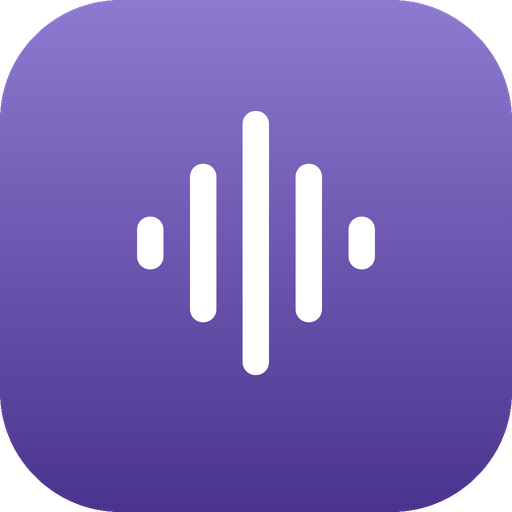
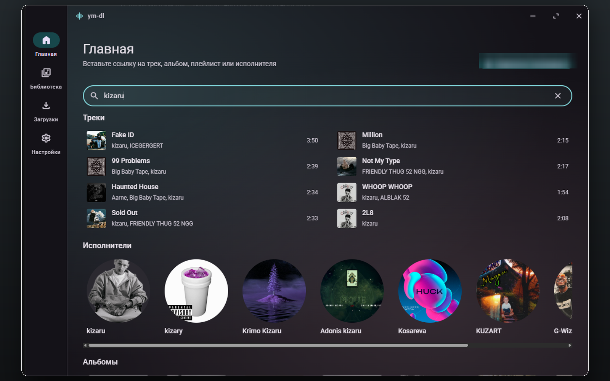
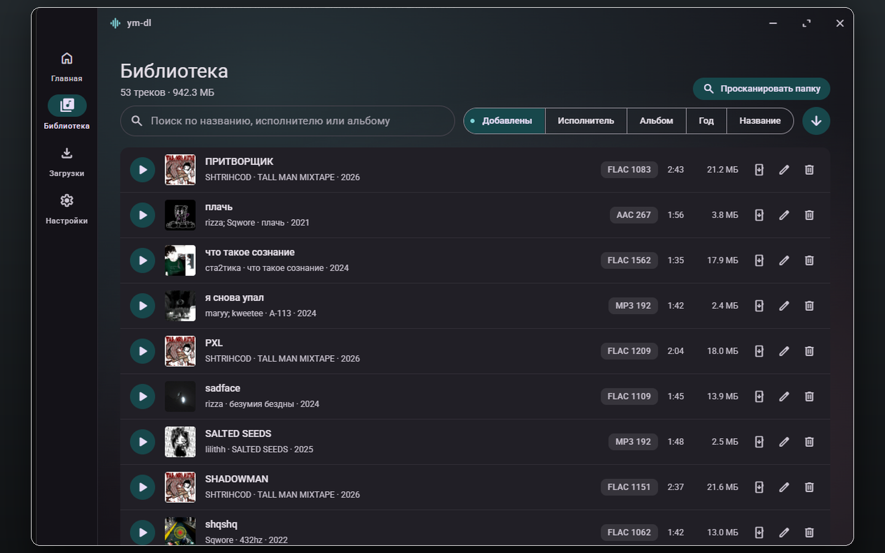

<div align="center">



# ym-dl

**Загрузчик Яндекс.Музыки для Windows, Linux и macOS.**

[](https://github.com/MrCripe/ym-dl/releases/latest)


[Скачать](https://github.com/MrCripe/ym-dl/releases/latest) ·
[Возможности](#возможности) ·
[Установка](#установка) ·
[Если что-то не работает](#если-что-то-не-работает) ·
[Сборка](#сборка-из-исходников)

<br>


</div>

<br>

Качает треки, альбомы, плейлисты, всё у исполнителя и «Мне нравится». Обложки и
теги вшиваются в файл, lossless сохраняется как FLAC. Скачанное можно слушать и
править теги прямо в приложении.

Нужен аккаунт Яндекс.Музыки. Для lossless — с подпиской Плюс.

> [!IMPORTANT]
> Это неофициальный проект. Он не связан с Яндексом, и Яндекс его не
> поддерживает. Названия и товарные знаки принадлежат их владельцам. Скачивайте
> только тот контент, который имеете право слушать.

## Возможности



- **Поиск.** Треки, исполнители, альбомы и плейлисты прямо в окне. Имя
  исполнителя находит его песни, а не одну карточку. Результат разложен как в
  привычном клиенте: треки в две колонки, ниже полки.
- **Несколько ссылок сразу.** Вставьте альбом, плейлист и трек одним куском —
  приложение разберёт ссылки и сложит всё в очередь. Битая ссылка не отменяет
  остальные.
- **Очередь.** Соберите что нужно, поменяйте порядок, нажмите «Начать». Загрузку
  можно поставить на паузу и продолжить с того же места.
- **Библиотека.** Всё скачанное одним списком: сортировка, поиск по словам,
  обложки. Правка тегов пишется в сам файл, а не только в базу.
- **Плеер.** Трек играет из библиотеки, полоса прогресса работает как перемотка.
  При переходе между экранами не сбрасывается.
- **Повышение качества.** Кнопка у трека перекачивает его в лучшем качестве, а
  кнопка над списком проходит по всей библиотеке сразу: показывает, сколько
  осталось, и останавливается по нажатию.
- **Плейлист и обложка рядом.** `.m3u8` на альбом, плейлист или «Мне нравится» и
  `cover.jpg` рядом с треком. Включается в настройках.
- **MP3 320.** Копия рядом с оригиналом для плееров, которые не читают FLAC и
  AAC. По умолчанию выключена.
- **История.** Отдельная вкладка в «Загрузках»: сколько всего скачано, сколько
  пропущено, сколько упало, и список прошлых загрузок.
- **Три шаблона раскладки.** Отдельно для «Мне нравится», альбомов и одиночных
  треков. Готовые варианты или свой шаблон.
- **Теги.** Название, исполнитель, исполнитель альбома, альбом, жанр, год, номер
  трека, ISRC, ссылка на трек, метка explicit и издатель. Обложка в максимальном
  разрешении.
- **Текст песни.** По умолчанию выключен. Из Яндекса с таймингами, вшивается в
  теги, рядом кладётся `.lrc`. Если текста нет, можно поискать на
  [lrclib.net](https://lrclib.net).
- **Реестр скачанного.** По идентификатору трека и ISRC. Смена шаблона не качает
  библиотеку заново.
- **Только музыка.** Подкасты и аудиокниги у исполнителя пропускаются.
- **Сеть и лимиты.** Сколько качать одновременно, таймаут, повторы, пауза между
  треками.
- **Оформление.** Тема, акцентный цвет, живой фон. Русский и английский язык.
- **Ничего доустанавливать не нужно.** FLAC, AAC и MP3 приложение разбирает само.



<sub>Библиотека: сортировка, поиск, качество и размер у каждого файла.</sub>

## Установка

Скачайте сборку для своей системы со [страницы релизов](https://github.com/MrCripe/ym-dl/releases/latest).

- **Windows** — установщик `.exe`. Есть портативная сборка:
  распакуйте и запустите, ничего не устанавливается. Нужен WebView2, в Windows 10
  и 11 он уже есть.
- **Linux** — `.deb` или `.AppImage`. Для AppImage нужен FUSE
  (`sudo apt install libfuse2`), либо распакуйте его через
  `--appimage-extract`.
- **macOS** — `.dmg` для Apple Silicon. Сборка без подписи: при первом запуске
  система попросит подтвердить приложение в «Системные настройки →
  Конфиденциальность и безопасность».

### Первый запуск

1. Нажмите «Войти в Яндекс». Откроется обычное окно входа, токен подхватится сам
   и сразу проверится на реальном запросе.
2. Вставьте ссылку на трек, альбом, плейлист или исполнителя и нажмите
   «Показать треки». Или найдите нужное поиском.
3. Отметьте треки, при желании добавьте ещё источники в очередь и нажмите
   «Начать».

Если токен уже есть, на экране входа есть «У меня уже есть токен».

По умолчанию файлы сохраняются в системную папку «Музыка» (`C:\Users\имя\Music`
на Windows, `~/Music` на Linux). Сменить можно в настройках. Журнал `ym-dl.log`
лежит рядом с программой.

## FLAC и lossless

Яндекс отдаёт lossless как FLAC внутри MP4-контейнера. Приложение само достаёт
дорожку и сохраняет её как `.flac` — доустанавливать ничего не надо.

Если к аккаунту не применена музыкальная подписка, сервер отвечает `aac-mp4`.
Приложение покажет это на экране входа и в настройках, а файлы останутся `.m4a`.
Это обычный рабочий файл, а не ошибка.


<sub>Настройки: аккаунт, папка, качество и отдельный шаблон на каждый источник.</sub>

## Если что-то не работает

| Симптом | Что делать |
| --- | --- |
| Не входит в аккаунт | Проверьте, что открылось окно Яндекса и вход завершён. Токен можно вставить вручную: «У меня уже есть токен». |
| Список треков пустой | Ссылка должна быть на `music.yandex.ru`. Приватный плейлист виден только своему аккаунту. |
| Файлы `.m4a`, а не FLAC | У аккаунта нет lossless — сервер отдаёт AAC. |
| Часть треков не скачалась | Уменьшите «Скачивать одновременно», включите паузу между треками: сервис ограничивает частоту запросов. |
| Windows пишет «Неизвестный издатель» | Сборки не подписаны платным сертификатом: «Подробнее» → «Выполнить всё равно». |
| macOS не даёт открыть | «Системные настройки → Конфиденциальность и безопасность» → «Всё равно открыть». |
| AppImage не запускается | Нужен FUSE: `sudo apt install libfuse2`. Либо `--appimage-extract` и `./squashfs-root/AppRun`. |
| Окно не открывается на Windows | Нужен WebView2. Поставьте «Evergreen WebView2 Runtime» от Microsoft. |
| Обновление не встало | Скачайте новый релиз вручную. Настройки и токен сохранятся. |

Точную причину любого сбоя смотрите в `ym-dl.log` рядом с программой.

## Что дальше

Не обещания со сроками, а направление.

**Прокси.** Для тех, кто слушает Яндекс.Музыку не из России: без прокси сервис
отвечает отказом.

**yt-dlp как второй источник.** YouTube Music, SoundCloud и всё остальное, что
он умеет. Отдельный режим, не замена Яндекса. Ставится рядом отдельным файлом.
Качество и теги там хуже, поэтому по умолчанию останется Яндекс.

**Подпись для macOS.** Сейчас система спрашивает подтверждение при первом
запуске, потому что сборка не подписана.

## Сборка из исходников

Нужны Node.js 20+, Rust (stable) и на Windows MSVC Build Tools с C++.

```bash
npm install
npm run app:build          # пакеты в src-tauri/target/release/bundle
```

Разработка с горячей перезагрузкой: `npm run app:dev`.

Linux: `./scripts/build-linux.sh`, нужны системные пакеты:

```bash
sudo apt install libwebkit2gtk-4.1-dev build-essential curl wget file \
  libxdo-dev libssl-dev libayatana-appindicator3-dev librsvg2-dev
```

Скриншоты пересобираются командой `python tools/make_renders.py` из снимков окна
в `docs/raw`.

## Как это устроено

Яндекс отдаёт lossless только десктопному клиенту. Подпись запроса
`get-file-info` делается ключом десктопного клиента, и ключ принимается только
вместе с заголовком `X-Yandex-Music-DesktopAppWindows`. Мобильная пара ключ плюс
заголовок lossless не получает.

Обновления подписаны отдельной парой ключей `minisign`: приватный лежит в
секретах репозитория (`TAURI_SIGNING_PRIVATE_KEY`), публичный в
`src-tauri/tauri.conf.json`. Без совпадения подписи обновление не установится.

```
src/                 React-фронтенд, дизайн-система M3 в styles/
src-tauri/src/       Rust-бэкенд
  api.rs             клиент Яндекс.Музыки, подпись, источники, поиск, ретраи
  audio.rs           AES-128-CTR, шаблоны путей, теги (lofty)
  mp4.rs             разбор MP4 и извлечение FLAC
  transcode.rs       проверка файла и MP3 320 через symphonia и LAME
  sidecar.rs         cover.jpg и .m3u8 рядом с файлами
  library.rs         реестр скачанного и история на SQLite
  image.rs           обложки как data URL
  lyrics.rs          тексты с таймингами, резерв lrclib.net
  download.rs        очередь, прогресс, пауза, повышение качества
  config.rs          настройки и токен
  commands.rs        мост между фронтендом и бэкендом
scripts/             сборка и правка манифеста обновлений
tools/               генераторы иконок, шрифтов и скриншотов (вручную)
```

## Лицензия

MIT, см. [LICENSE](LICENSE).

Проект не связан с Яндексом. Скачивайте только тот контент, который имеете право
слушать, и соблюдайте условия сервиса.
