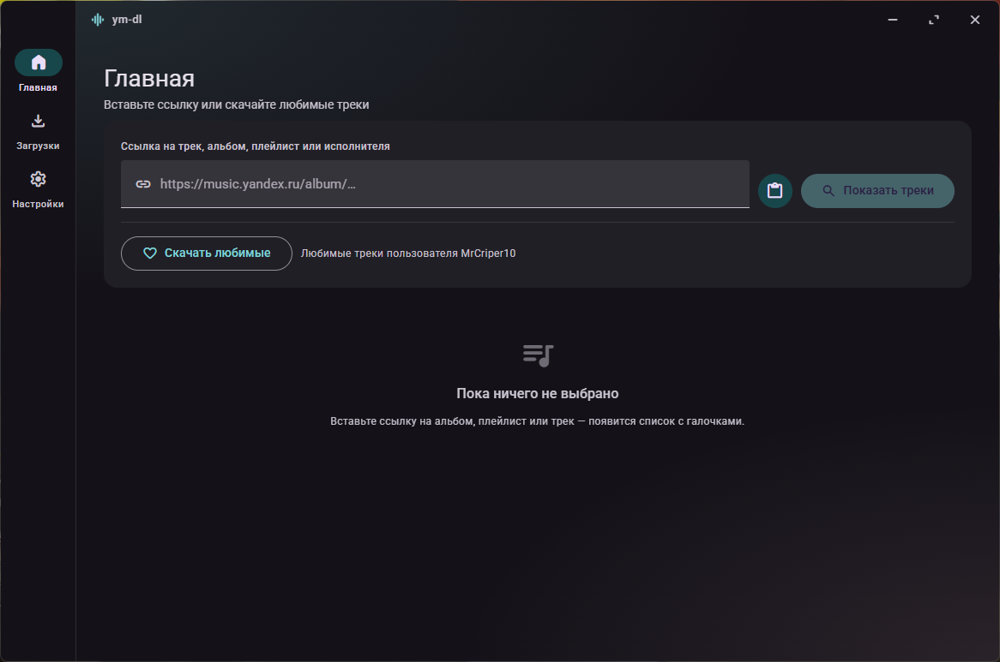
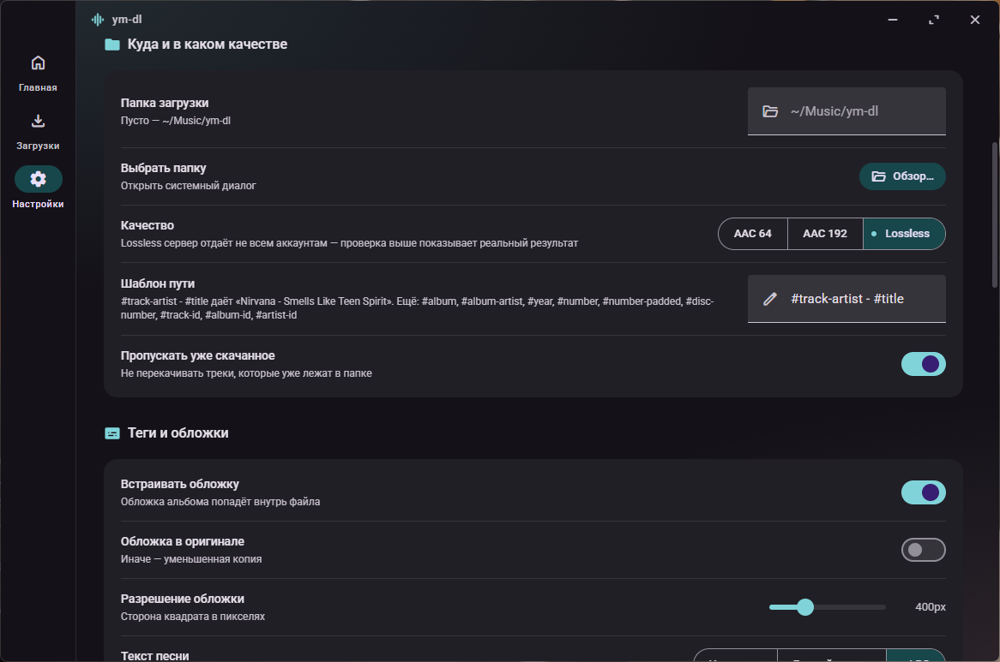

# ym-dl

Загрузчик Яндекс.Музыки с графическим интерфейсом на Material Design 3.
Windows и Linux, без установки зависимостей.



Качает треки, альбомы, плейлисты, все треки исполнителя и «Мне нравится»,
показывает реальный прогресс по байтам, умеет остановиться посреди загрузки и
вытаскивает настоящий FLAC из `.m4a`. Обложка, теги и текст песни с таймингами
вшиваются в файл.

## Скачать

**[Последний релиз →](https://github.com/MrCripe/ym-dl/releases/latest)**

| Что у вас | Какой файл взять |
| --- | --- |
| Windows 10/11, 64-bit | `ym-dl_*_x64-setup.exe` — установщик, или `ym-dl_*_windows-portable.zip` — распаковать и запустить `ym-dl.exe` |
| Linux | `.AppImage` — `chmod +x` и запуск, или `.deb` |

Портативные архивы — уже собранная программа без установщика. Настройки лежат
рядом, в папке `ym-dl-data`, и переезжают вместе с ней.

Что изменилось между версиями — [CHANGELOG.md](CHANGELOG.md).

**Windows покажет «Неизвестный издатель»** — сборки не подписаны платным
сертификатом. Это ожидаемо: «Подробнее» → «Выполнить всё равно».

## Первый запуск

1. Нажмите «Войти в Яндекс» — откроется обычное окно входа Яндекса, токен
   подхватится сам и сразу проверится на реальном запросе.
2. Вставьте ссылку на трек, альбом, плейлист или исполнителя и нажмите
   «Показать треки».
3. Отметьте нужное и скачайте.

Уже есть токен? Внизу экрана входа есть «У меня уже есть токен».


## Что умеет

- **Вход из приложения** — окно входа Яндекса, токен подхватывается сам.
  Аккаунт проверяется сразу: приложение показывает, отдаёт ли сервис FLAC
  именно вам.
- **Выбор треков** — после разбора ссылки появляется список с галочками,
  кнопки «Выбрать все» и «Снять все».
- **Загрузки** — отдельная страница: круг с процентом, счётчики, построчный
  прогресс и журнал.
- **Настройки** — папка, шаблон пути, качество, пропуск готового, обложки,
  текст песни, уровень совместимости тегов, параллельность, таймауты, повторы,
  паузы, постобработка FLAC, тема и акцент. Сохраняются сами, через полсекунды
  после последнего изменения.
- **Текст песни с таймингами** — берётся из Яндекса в формате LRC и вшивается в
  теги; рядом появляется `.lrc` для плееров, которые подсвечивают строку. Если в
  Яндексе текста нет, он ищется в открытой базе [lrclib.net](https://lrclib.net).
- **Обновления** — приложение проверяет свои релизы и обновляется само:
  «Настройки → Обновления → Обновить». Переустанавливать вручную не нужно.
- **Токен в системном хранилище** — Windows Credential Manager или Secret
  Service на Linux, а не файлом на диске.



## Про ffmpeg

Для извлечения FLAC из MP4-контейнера нужен `ffmpeg`. **Без него всё работает**,
просто файлы останутся `.m4a` (AAC) — это обычные файлы, они играют везде,
просто не lossless.

Нужен FLAC — поставьте ffmpeg и перезапустите приложение:

- Windows: скачайте сборку с [gyan.dev](https://www.gyan.dev/ffmpeg/builds/),
  распакуйте, добавьте папку `bin` в `PATH`.
- Linux: `sudo apt install ffmpeg`.

Приложение находит ffmpeg в `PATH` и показывает путь в настройках, в разделе
«FLAC и постобработка».

## Про lossless

Яндекс отдаёт lossless как FLAC внутри MP4-контейнера. Подпись запроса
`get-file-info` делается ключом десктопного клиента, а сам ключ принимается
только вместе с заголовком `X-Yandex-Music-DesktopAppWindows`; мобильная пара
ключ+заголовок lossless не получает.

Если аккаунту музыкальная подписка не применена, сервер отвечает `aac-mp4` —
приложение честно покажет это на экране входа и в настройках, а файлы
останутся `.m4a`. Это нормальный рабочий файл, а не ошибка.

## Если что-то не работает

| Симптом | Что делать |
| --- | --- |
| Не входит в аккаунт | Проверьте, что открылось окно именно Яндекса и вход завершён. Токен можно вставить вручную: «У меня уже есть токен». |
| Список треков пустой | Ссылка должна быть на `music.yandex.ru`. Приватный плейлист виден только своему аккаунту. |
| Файлы `.m4a`, а не FLAC | Нет ffmpeg или у аккаунта нет lossless — см. разделы выше. |
| Антивирус удалил exe | Сборки не подписаны. Добавьте файл в исключения или соберите сами. |
| Обновление не встало | Скачайте новый релиз вручную: настройки и токен сохранятся. |

## Токен и данные

Приложение портативное: настройки и профиль WebView2 лежат в папке
`ym-dl-data` рядом с исполняемым файлом. Папку можно перенести целиком — вход
и настройки переедут вместе с ней.

Сам токен хранится в системном хранилище паролей: Windows Credential Manager
или Secret Service на Linux. В файле он оказывается только там, где такого
хранилища нет, — тогда приложение пишет об этом в журнал.

Вручную токен можно получить на <https://ym.marshal.dev/token/> — это
независимый сайт, не связанный с проектом. Токен даёт доступ к аккаунту,
поэтому не передавайте его никому.

Если папка рядом с программой недоступна для записи (например, установка в
`Program Files`), настройки уходят в каталог конфигурации (`%APPDATA%\ym-dl`
на Windows, `~/.config/ym-dl` на Linux).

## Обновления

Приложение проверяет свои релизы через ленту `releases.atom` и обновляется
само: «Настройки → Обновления → Проверить», затем «Обновить». Новый файл
скачивается, проверяется по подписи и устанавливается на место старого.

Подпись обновлений — отдельная пара ключей (`minisign`). Приватный ключ лежит
в секретах репозитория (`TAURI_SIGNING_PRIVATE_KEY`), публичный — в
`src-tauri/tauri.conf.json`. Без совпадения подписи обновление не установится:
так никто не подменит файл по дороге.

Если программа запущена как портативная сборка, после обновления её файлы
переезжают в папку установки. Настройки и токен переезжают следом — при
следующем запуске приложение находит прежнюю папку `ym-dl-data` и забирает её
себе.

## Сборка из исходников

Нужны Node.js 20+, Rust (stable) и для Windows — MSVC Build Tools с C++.

```bash
npm install
npm run app:build          # готовые пакеты в src-tauri/target/release/bundle
```

Разработка с горячей перезагрузкой — `npm run app:dev`, только фронтенд —
`npm run dev` (http://localhost:1420).

Windows: `.\scripts\build-windows.ps1`. Linux: `./scripts/build-linux.sh`,
нужны системные пакеты:

```bash
sudo apt install libwebkit2gtk-4.1-dev build-essential curl wget file \
  libxdo-dev libssl-dev libayatana-appindicator3-dev librsvg2-dev
```

## Структура

```
src/                 React-фронтенд, дизайн-система M3 в styles/
src-tauri/src/       Rust-бэкенд
  api.rs             клиент Яндекс.Музыки, подпись, источники, ретраи
  audio.rs           AES-128-CTR, шаблоны путей, теги (lofty)
  ffmpeg.rs          извлечение FLAC из .m4a
  lyrics.rs          тексты с таймингами, резерв lrclib.net
  download.rs        очередь загрузки, прогресс, остановка
  config.rs          настройки и токен
  updates.rs         проверка обновлений
  commands.rs        мост между фронтендом и бэкендом
scripts/             сборка и правка манифеста обновлений
tools/               генераторы иконок и шрифтов (запускаются вручную)
```

## Лицензия

MIT — см. [LICENSE](LICENSE).

Проект не связан с Яндексом. Скачивайте только тот контент, который имеете
право слушать, и соблюдайте условия сервиса.
