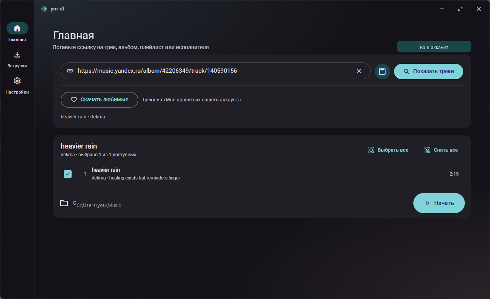

# ym-dl

Загрузчик Яндекс.Музыки для Windows и Linux. Интерфейс на Material Design 3.
Бесплатный, открытый, MIT.

**[Скачать последнюю версию →](https://github.com/MrCripe/ym-dl/releases/latest)**

Нужен аккаунт Яндекс.Музыки. Качает треки, альбомы, плейлисты, всё у
исполнителя и «Мне нравится». Обложки и теги вшиваются в файл.


## Первый запуск

1. Нажмите «Войти в Яндекс». Откроется обычное окно входа, токен подхватится сам
   и сразу проверится на реальном запросе.
2. Вставьте ссылку на трек, альбом, плейлист или исполнителя и нажмите
   «Показать треки».
3. Отметьте нужное и скачайте.

Если токен уже есть, внизу экрана входа есть «У меня уже есть токен».

Куда качается по умолчанию: системная папка «Музыка» (`C:\Users\имя\Music` на
Windows, `~/Music` на Linux). Сменить можно в настройках, раздел «Куда
сохранять». Кнопка «Открыть папку» на экране загрузок открывает её сразу.

Если что-то пошло не так, рядом с программой лежит журнал `ym-dl.log`. В нём
причина сбоя.



## Что умеет

- **Вход из приложения.** Окно входа Яндекса, токен подхватывается сам. Аккаунт
  проверяется сразу: приложение показывает, отдаёт ли сервис FLAC именно вам.
- **Выбор треков.** После разбора ссылки появляется список с галочками и кнопки
  «Выбрать все» и «Снять все».
- **Загрузки.** Отдельная страница с кругом процента, счётчиками, построчным
  прогрессом и журналом. Загрузку можно остановить посреди работы.
- **Качество.** Три варианта: AAC 64, AAC 192 и Lossless. По умолчанию Lossless.
  Если аккаунт его не отдаёт, приложение скажет об этом и сохранит AAC.
- **Раскладка файлов.** Готовые варианты с примером результата: любимые треки,
  синглы, альбомы, по годам, всё в одну папку. Свой шаблон тоже можно.
- **Пропуск готового.** Включён по умолчанию: треки, которые уже лежат в папке,
  заново не качаются.
- **Текст песни.** По умолчанию выключен. Берётся из Яндекса в формате LRC и
  вшивается в теги, рядом появляется `.lrc` для плееров с подсветкой строк. Если
  в Яндексе текста нет, можно поискать в открытой базе
  [lrclib.net](https://lrclib.net). Это экспериментальная функция: база
  ограничивает частоту запросов, поэтому при большой загрузке часть текстов
  может не найтись.
- **Только музыка.** Подкасты и аудиокниги у исполнителя пропускаются. Есть
  отдельный переключатель, чтобы не брать сборники, где исполнитель лишь один из
  участников.
- **Сеть и лимиты.** Сколько треков качать одновременно, таймаут, число
  повторов, пауза между треками.
- **Оформление.** Тема (системная, светлая, тёмная) и акцентный цвет.
- **Язык интерфейса.** Русский или английский, по умолчанию как в системе.
- **Обновления.** Приложение находит новую версию и ставит её само. Кнопка
  «Обновить» появляется внизу экрана, когда обновление есть.
- **Токен в системном хранилище.** Windows Credential Manager или Secret Service
  на Linux. Если хранилища в системе нет, приложение скажет, что токен лёг в
  файл, и предупредит, что папку нельзя копировать на чужой компьютер.


## FLAC и lossless

Яндекс отдаёт lossless как FLAC внутри MP4-контейнера, поэтому файл сначала
получается `.m4a`. Чтобы достать из него FLAC, нужен `ffmpeg`, отдельная
программа для работы с медиафайлами. Без него всё работает, просто файлы
останутся `.m4a` (AAC). Это обычные файлы, они играют везде, просто не lossless.

Нужен FLAC? Поставьте ffmpeg и перезапустите приложение:

- Windows: скачайте сборку с [gyan.dev](https://www.gyan.dev/ffmpeg/builds/),
  распакуйте, добавьте папку `bin` в `PATH` (список папок, где Windows ищет
  программы).
- Linux: `sudo apt install ffmpeg`.

Приложение находит ffmpeg в `PATH` и показывает путь в настройках, в разделе
«FLAC и постобработка».

Уже скачанные `.m4a` сами в FLAC не превратятся: для них есть кнопка
«Перепаковать папку сейчас» в том же разделе. Она проходит по папке загрузки и
перепаковывает каждый файл, а исходный `.m4a` удаляет после проверки, что FLAC
читается. Поэтому кнопка сначала спрашивает подтверждение: под неё попадут и
файлы, скачанные не этой программой.

Если к аккаунту не применена музыкальная подписка, сервер отвечает `aac-mp4`.
Приложение покажет это на экране входа и в настройках, а файлы останутся `.m4a`.
Это нормальный рабочий файл, а не ошибка.

## Если что-то не работает

| Симптом | Что делать |
| --- | --- |
| Не входит в аккаунт | Проверьте, что открылось окно именно Яндекса и вход завершён. Токен можно вставить вручную: «У меня уже есть токен». |
| Список треков пустой | Ссылка должна быть на `music.yandex.ru`. Приватный плейлист виден только своему аккаунту. |
| Файлы `.m4a`, а не FLAC | Нет ffmpeg или у аккаунта нет lossless. Смотрите раздел выше. Старые файлы перепакует кнопка «Перепаковать папку сейчас». |
| Часть треков не скачалась | Уменьшите «Скачивать одновременно» и включите паузу между треками: сервис ограничивает частоту запросов. |
| Windows пишет «Неизвестный издатель» | Сборки не подписаны платным сертификатом. «Подробнее» → «Выполнить всё равно». Если антивирус удалил exe, добавьте файл в исключения или соберите сами. |
| AppImage не запускается на Linux | Нужен FUSE: `sudo apt install libfuse2`, `sudo pacman -S fuse2` или `sudo dnf install fuse`. Либо распакуйте: `./ym-dl.AppImage --appimage-extract` и запустите `squashfs-root/AppRun`. |
| Окно не открывается на Windows | Нужен WebView2, в Windows 10 и 11 он есть по умолчанию. Если нет, поставьте «Evergreen WebView2 Runtime» от Microsoft. |
| Обновление не встало | Скачайте новый релиз вручную. Настройки и токен сохранятся. |

Точную причину любого сбоя смотрите в `ym-dl.log` рядом с программой.

## Что дальше

Это не обещания со сроками, а направление.

**Библиотека.** Отдельный раздел с тем, что уже скачано: сортировка по году,
исполнителю и альбому. Оттуда же правка метаданных, удаление песен и повторная
загрузка трека в лучшем качестве, если аккаунт его отдаёт. Сейчас всё это
приходится делать в проводнике и сторонним редактором тегов.

**Поиск внутри приложения.** Пока без ссылки приложение бесполезно: трек надо
сначала найти в браузере. Поиск по трекам, альбомам и исполнителям прямо в
приложении убирает этот шаг.

**Список уже скачанного.** Сейчас трек считается скачанным, если файл лежит по
ожидаемому пути. Сменили шаблон раскладки, и приложение качает всю библиотеку
заново, а трек из трёх плейлистов ложится тремя копиями. Отдельный список по
идентификатору трека это снимает.

**Несколько ссылок сразу.** Список ссылок или файл с ними, чтобы поставить в
очередь десять альбомов за один раз.

**Прокси.** Для тех, кто слушает Яндекс.Музыку не из России: без прокси сервис
отвечает отказом.

**Скачивание через yt-dlp, опционально.** Кроме Яндекса появится второй
источник: YouTube Music, SoundCloud и всё остальное, что умеет
[yt-dlp](https://github.com/yt-dlp/yt-dlp). Отдельный режим, не замена
Яндекс.Музыки. yt-dlp будет ставиться рядом отдельным файлом, а не встроится в
программу. Один интерфейс на несколько сервисов, но качество и теги там хуже,
поэтому по умолчанию останется Яндекс.

**macOS.** Код на Rust и Tauri переносится почти без изменений. Нужны сборка под
оба типа процессоров (Intel и Apple Silicon), подпись приложения для Gatekeeper
и проверка Keychain. Пока платформы две: Windows и Linux.

**Своя раскладка для каждого источника.** Сейчас шаблон пути один на всё.
Планируется, что у «Мне нравится», у альбомов и у одиночных треков шаблоны будут
отдельными. В каждом можно выбрать готовый вариант или написать свой.

## Сборка из исходников

Нужны Node.js 20+, Rust (stable) и для Windows MSVC Build Tools с C++.

```bash
npm install
npm run app:build          # готовые пакеты в src-tauri/target/release/bundle
```

Разработка с горячей перезагрузкой: `npm run app:dev`. Собрать только фронтенд:
`npm run dev` (http://localhost:1420).

Windows: `.\scripts\build-windows.ps1`. Linux: `./scripts/build-linux.sh`, нужны
системные пакеты:

```bash
sudo apt install libwebkit2gtk-4.1-dev build-essential curl wget file \
  libxdo-dev libssl-dev libayatana-appindicator3-dev librsvg2-dev
```

## Как это устроено

Яндекс отдаёт lossless только десктопному клиенту. Подпись запроса
`get-file-info` делается ключом десктопного клиента, и ключ принимается только
вместе с заголовком `X-Yandex-Music-DesktopAppWindows`. Мобильная пара ключ плюс
заголовок lossless не получает.

Для подписи обновлений используется отдельная пара ключей `minisign`: приватный
лежит в секретах репозитория (`TAURI_SIGNING_PRIVATE_KEY`), публичный в
`src-tauri/tauri.conf.json`. Без совпадения подписи обновление не установится:
так никто не подменит файл по дороге.

```
src/                 React-фронтенд, дизайн-система M3 в styles/
src-tauri/src/       Rust-бэкенд
  api.rs             клиент Яндекс.Музыки, подпись, источники, ретраи
  audio.rs           AES-128-CTR, шаблоны путей, теги (lofty)
  ffmpeg.rs          извлечение FLAC из .m4a
  lyrics.rs          тексты с таймингами, резерв lrclib.net
  download.rs        очередь загрузки, прогресс, остановка
  config.rs          настройки и токен
  updates.rs         проверка обновлений
  commands.rs        мост между фронтендом и бэкендом
scripts/             сборка и правка манифеста обновлений
tools/               генераторы иконок и шрифтов (запускаются вручную)
```

## Лицензия

MIT, см. [LICENSE](LICENSE).

Проект не связан с Яндексом. Скачивайте только тот контент, который имеете право
слушать, и соблюдайте условия сервиса.
